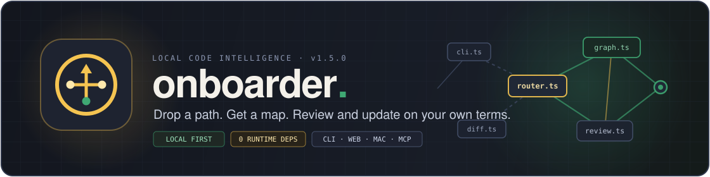
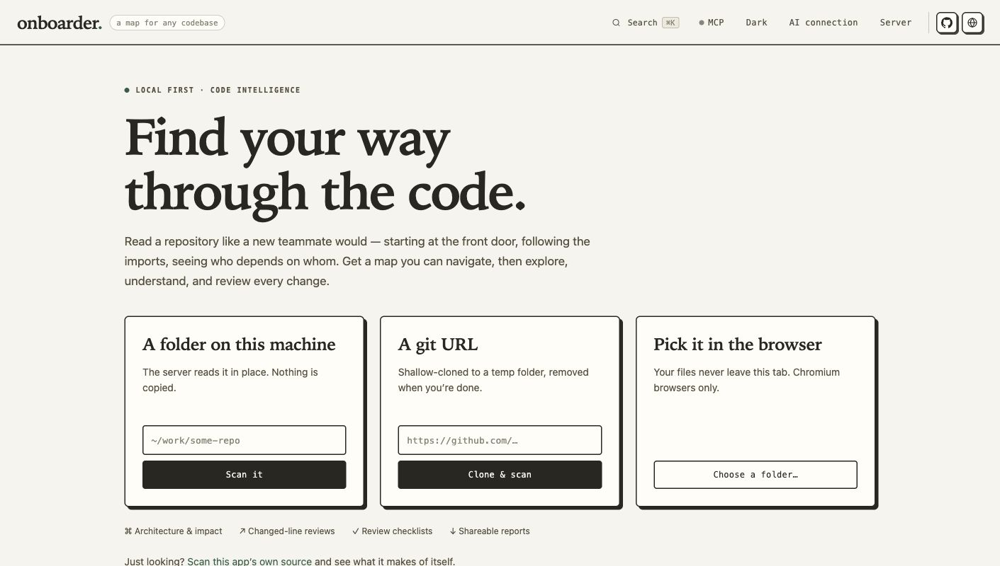
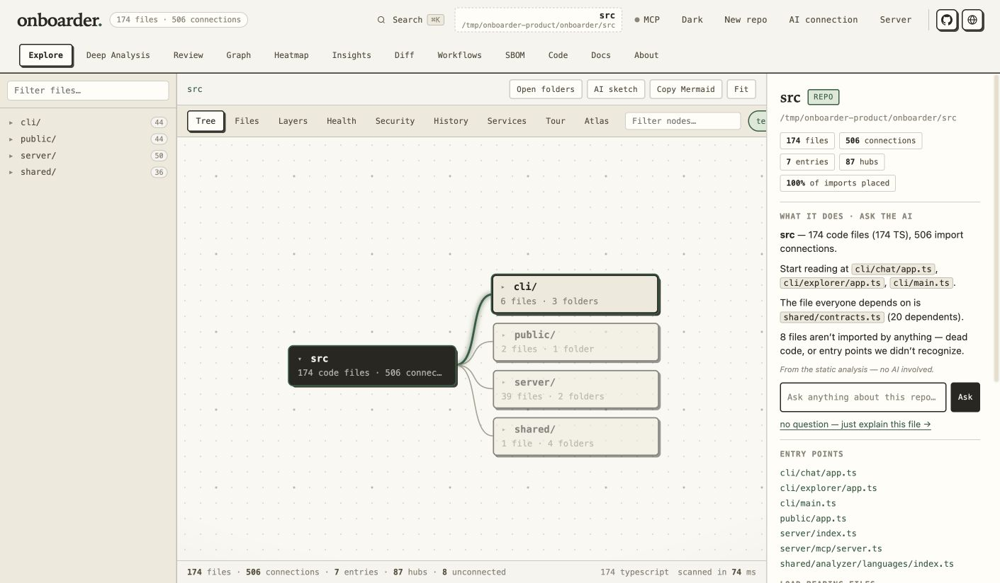
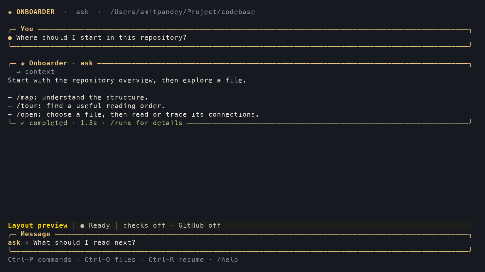

<div align="center">
  <picture>
    <source media="(prefers-color-scheme: dark)" srcset="https://raw.githubusercontent.com/Amitpandey88/onboarder/main/docs/images/hero-dark.svg">
    <source media="(prefers-color-scheme: light)" srcset="https://raw.githubusercontent.com/Amitpandey88/onboarder/main/docs/images/hero-light.svg">
    
  </picture>

  <h1>Onboarder 🧭</h1>

  <p>
    <a href="https://onboarder.amit.codes/">Website &amp; Docs</a> ·
    <a href="https://onboarder.amit.codes/docs/macos/">Onboarder for Mac</a> ·
    <a href="https://github.com/Amitpandey88/onboarder/releases/tag/v1.5.0">Release v1.5.0</a> ·
    <a href="https://github.com/Amitpandey88/onboarder/releases/tag/macos-v0.1.7">Mac v0.1.7</a> ·
    <a href="CHANGELOG.md">Changelog</a>
  </p>

  <p>
    <a href="https://onboarder.amit.codes/"></a>
    <a href="https://www.npmjs.com/package/codebase-onboarder"></a>
    <a href="https://github.com/Amitpandey88/onboarder/releases/tag/macos-v0.1.7"></a>
    <a href="LICENSE"></a>
    <a href="package.json"></a>
    <br>
    <a href="https://github.com/Amitpandey88/onboarder/actions/workflows/ci.yml"></a>
    <a href="https://amit.codes/"></a>
    <a href="docs/SUPPLY_CHAIN_SECURITY.md"></a>
  </p>
</div>

**Drop a path. Get a map.**
Onboarder is a local-first codebase visualizer, review workbench, and architecture explorer with **zero core runtime dependencies**. It reads a repository the way a senior engineer does — tracing entry points, import graphs, architectural layers, Change Stacks, dead exports, dependency drift, and Git hotspots across a terminal app, offline explorer, web UI, standalone MCP server, and native Apple Silicon Mac app.

Core analysis runs on your machine with no account and no telemetry. Optional AI features connect to your configured OpenAI-compatible endpoint or Hermes profile.

<div align="center">
  <a href="https://github.com/Amitpandey88/onboarder/blob/main/showcase/onboarder-showcase.mp4">
    
  </a>
  <br>
  <sub>12-second animated preview · <a href="https://github.com/Amitpandey88/onboarder/blob/main/showcase/onboarder-showcase.mp4">Watch full 40s 1080p film</a> · <a href="https://github.com/Amitpandey88/onboarder/tree/main/showcase">Storyboard &amp; assets</a></sub>
</div>

---

## Choose Your Workspace

| Surface | Launch / Install | Best For | Built-in Auto-Update |
|---|---|---|---|
| **Terminal Chat** | `onboarder` | Interactive analysis, `/open`, `/review`, `/deep`, Hermes workflows | `/update` & background check |
| **Offline Explorer** | `onboarder explore .` | Script-free interactive browsing, maps, blast radius | `update` command |
| **Web Workspace** | `onboarder start` | Interactive maps, Change Stack, Review, Fixes, Triage, Monaco | **Updates** drawer + landing banner |
| **macOS App (Preview)** | [Download `.dmg` / `.zip`](https://github.com/Amitpandey88/onboarder/releases/tag/macos-v0.1.7) | Multi-window projects, embedded PTY/Chat terminals, Keychain | GitHub Releases (`macos-v*`), SHA-256 & `codesign` swap |
| **MCP Server** | `onboarder mcp` | Exposing 17 local tools & Change Stack projections to AI IDEs | Managed via `onboarder update` |
| **VS Code Extension** | `integrations/vscode/` | Editor-side PR triage & repository checks | Uses installed `onboarder` CLI |

---

## ⚡ Quickstart

### Install & Run CLI / Web UI (`v1.5.0`)

```bash
# Install globally from npm (Node.js 20+, zero runtime dependencies)
npm install -g codebase-onboarder

# Launch interactive terminal chat in the current repo
onboarder

# Browse offline in the terminal explorer
onboarder explore .

# Start the web workspace at http://localhost:4310
onboarder start

# Check for or apply updates directly from the command line
onboarder update
```

<details>
<summary>Install or run from source</summary>

```bash
git clone https://github.com/Amitpandey88/onboarder.git
cd onboarder
npm ci --ignore-scripts
npm run build
npm start
```

Compiled artifacts live in `cli/`, `server/`, `shared/`, and `public/js/`; canonical TypeScript source lives in `src/`. Use `npm run dev` during active development.

</details>

### Apple Silicon Mac App (`macos-v0.1.7`)

Download the preview DMG or ZIP from [macos-v0.1.7](https://github.com/Amitpandey88/onboarder/releases/tag/macos-v0.1.7) (Apple Silicon, macOS 14+, bundles isolated Node `24.20.0`, `npm`, `onboarder`, and shell/chat PTY terminals).

> [!NOTE]
> The macOS preview is ad-hoc signed and not notarized; Gatekeeper may warn on first launch when opened outside a signed Developer ID flow. Starting in `macos-v0.1.7`, the app includes in-app release checking, `SHA256SUMS` + code-signature verification, and atomic `.app` updates (with verified `.dmg` download fallback when running from source or under App Translocation).

---

## 🔄 What's New in v1.5.0 & Mac v0.1.7

Release **1.5.0** and **macos-v0.1.7** add end-to-end **update detection and controlled self-updates** across every Onboarder surface:

- **CLI (`onboarder update`)**: `onboarder update`, `onboarder update check`, and `onboarder update install` check npm with a 12-hour cache, verify Node engine compatibility, explain install methods (`npm-global`, `npm-local`, `npx`, `source`), ask confirmation in TTY, and run pinned `npm install -g codebase-onboarder@<ver> --ignore-scripts`. Also surfaced in `status`, `doctor`, `start`, `/update`, and explorer `update`.
- **Web UI & Server API**: New topbar status indicator (`#updateBtn`), dismissible Project Home banner, live **Updates** drawer with SSE streaming install logs, release notes, auto-check toggle (`config.updateCheck`), and **Restart & reload**. Endpoints (`GET /api/update`, `POST /api/update/install`, `POST /api/update/restart`) enforce same-origin checks and self-hosted owner authentication.
- **macOS Desktop App**: Checks `macos-v*` tags on GitHub Releases, surfaces status in the topbar, Project Home banner, **System** dialog, and **Onboarder → Check for Updates…**, verifies downloads against `SHA256SUMS`, validates `Info.plist` + `/usr/bin/codesign --verify --deep --strict` + signing continuity, swaps `Onboarder.app` atomically with rollback, and cleanly restarts on user confirmation. Set `ONBOARDER_NO_UPDATE_CHECK=1` to disable automatic background checks everywhere.

See [Release 1.5.0 notes](docs/RELEASE_1.5.0.md) · [Release 1.4.0](docs/RELEASE_1.4.0.md) · [Change Stack guide](docs/CHANGE_STACK.md) · [Full Changelog](CHANGELOG.md).

---

## 🖼️ Product Previews

**Web Landing — load a local folder, a Git URL, or an in-browser directory.**



**Explore — trace entry points, dependencies, layers, health, and risk hotspots.**



**Terminal Chat — message blocks, command search (`Ctrl-P`), file explorer (`Ctrl-O`), and pinned composer.**



<sub>Web captures show the published 1.0.5 interface; the terminal capture shows a 1.0.4 session with a controlled sample reply (`Layout preview`). AI configuration is optional for repository analysis.</sub>

---

## 🔍 Core Capabilities

### Change Stack & Review Workbench
- **Phase 4B Change Stack** ([guide](docs/CHANGE_STACK.md)): Turns exact-revision Git snapshots (`onboarder intelligence changes . --base <ref> --head <ref>`) into ordered contract, dependency/boundary, implementation, test, documentation, and configuration groups with before/after dependency overlays, move alignment, and optional TypeScript semantic symbol tracking.
- **Local & Contextual Review** ([guide](docs/CONTEXTUAL_AI_REVIEW.md)): `onboarder review .` evaluates working-tree, staged, or branch diffs against security and quality rules, redacts secrets, and supports optional bounded `--ai` review with validated source citations.
- **Digest-Approved Fixes & Verification** ([guide](docs/AI_FIX_VERIFICATION.md)): `onboarder fix propose|show|apply|verify|status|rollback|accept` creates read-only proposals, requires exact patch-digest approval, applies edits into isolated Git worktrees with checkpoint rollback, and runs separately authorized checks.
- **Read-Only PR Triage** ([guide](docs/PR_TRIAGE.md)): `onboarder triage list|inspect` computes explainable P0–P3 priorities, CODEOWNERS suggestions, and head-SHA CI context across CLI, Web, MCP, and VS Code.

### Interactive Maps, Graph Analytics & Security
- **Nine-View Architecture Canvas**: `Tree`, `Files`, `Layers`, `Health` (PageRank + Tarjan SCC + complexity heatmap), `Security` (secrets, SQL/command/eval sinks, XSS), `History` (churn × complexity), `Services`, `Tour`, and `Atlas`.
- **Advanced Graph Engine**: TypeScript path-alias resolution, symbol-level dead export detection, manifest-vs-import dependency drift, test-reachability tracing, search (`Cmd/Ctrl+K` with `ext:`, `path:`, `is:test`, `/regex/`), and Monaco read-only viewer for 70+ languages.
- **Deep Analysis Engines (Optional)**: Integrates with [Semgrep](https://github.com/semgrep/semgrep), [Gitleaks](https://github.com/gitleaks/gitleaks), [Knip](https://github.com/webpro-nl/knip), [Vulture](https://github.com/jendrikseipp/vulture), and [Depcheck](https://github.com/depcheck/depcheck) — detected locally, installed only on explicit action, spawned safely with argument arrays (never shell `eval`).

<details>
<summary> Ways to load a repository & scan options </summary>

1. **Local Directory** — Enter any path (`~/work/repo`). Scanned in place without copying files.
2. **Git URL** — Shallow-cloned (`--depth 1`) to temporary isolated storage (or saved persistently in the Mac app).
3. **In-Browser Picker** — File System Access API (Chrome/Edge); files never leave the browser tab.
4. **Demo Mode** — *"Scan this app's own source"* on landing.

Defaults are `4,000` files, `200 KiB` per file, and `8` concurrent reads (configurable up to `100,000` files / `10 MiB` via `--max-files`, `--max-file-size`, `--read-concurrency`, or `POST /api/scan`).

</details>

---

## 🖥️ Terminal App, Explorer & Hermes Agent

Run `onboarder` for the full-screen Hermes-powered chat workspace, `onboarder explore` for offline command-line exploration, or `onboarder report . --json` for CI scripts.

<details>
<summary>Terminal navigation shortcuts, slash commands, explorer commands, and Hermes workflows</summary>

| Shortcut / Command | Purpose |
|---|---|
| `Ctrl-P` | Open searchable command palette while preserving drafts |
| `Ctrl-O` / `/open [query]` | Search files & inspect source, deps, graph, blast radius |
| `Ctrl-R` / `/resume` | Resume saved conversations for the active repository |
| `PgUp` / `PgDn` / `Ctrl-End` | Scroll conversation history without losing your prompt |
| `/ask`, `/review`, `/triage`, `/implement`, `/pr`, `/github` | Multi-step workflows via optional configured provider or Hermes |
| `/map`, `/tree`, `/find`, `/show`, `/diff`, `/health`, `/rescan` | Offline repository browsing and analysis |
| `/deep`, `/engines`, `/model`, `/permissions`, `/limits`, `/update` | External analyzers, provider configuration, permissions, self-update |

One-shot & agent commands:

```bash
onboarder report . --json
onboarder update check --json
onboarder agent setup && onboarder agent doctor
onboarder agent ask . --task "Explain authentication boundaries"
onboarder agent review . --pr 42 --task "Review security and tests"
onboarder intelligence changes . --base main --head HEAD --json
```

All agent `implement` / `pr` source writes stay confined to isolated Git worktrees from committed `HEAD` with `--allow-checks` and `--allow-github-writes` defaulting strictly off. See [Hermes research](docs/HERMES_RESEARCH.md).

</details>

---

## 🔌 MCP Server & ⚙️ Self-Hosting

Expose the local analysis engine over stdio **Model Context Protocol** (`node bin/onboarder.js mcp` or `node server/mcp/standalone.js`) to Claude Code, Cursor, Claude Desktop, Cline, or Windsurf (**17 tools**, cached resources, and guided prompts).

Run Onboarder on a VPS or server with explicit owner authentication (`HttpOnly`, `SameSite=Strict` cookies or `Authorization: Bearer`), automatic Caddy HTTPS, login-item registration (`launchd` / `systemd` / Windows Startup), Cloudflare quick tunnels, and Tailscale support:

```bash
onboarder setup --mode self-hosted --domain map.example.com --https --start
onboarder start background
onboarder status
onboarder doctor
```

<details>
<summary>MCP client configuration & self-hosting commands reference</summary>

```json
{
  "mcpServers": {
    "onboarder": {
      "command": "node",
      "args": ["/absolute/path/to/onboarder/server/mcp/standalone.js"]
    }
  }
}
```

```bash
onboarder mcp config        # print JSON config (or add `toml`)
onboarder mcp check --json  # verify live stdio initialization
onboarder config set port 4311
onboarder config key rotate
onboarder tunnel cloudflare
onboarder https check && onboarder https setup
onboarder start startup install
```

</details>

---

## 🛠️ Architecture & Testing

```text
onboarder/
├── src/                    # Canonical TypeScript source
│   ├── cli/                # Wizard, update CLI, lifecycle, explorer & chat
│   ├── server/             # HTTP router, auth, Change Stack, update & MCP server
│   ├── shared/             # Portable analyzer, graph, review, fix & update core
│   └── public/             # Browser ES modules, Monaco/Mermaid views & Desktop bridge
├── integrations/
│   ├── macos/              # Electron Mac app, PTY terminals, native menu & updater
│   └── vscode/             # VS Code triage extension & offline VSIX packager
├── website/                # Static site & documentation builder (onboarder.amit.codes)
├── scripts/                # Build verification & supply-chain integrity guards
└── tests/                  # Native node:test suite + frontend & security checks
```

```bash
npm ci --ignore-scripts
npm run check               # typecheck, test suite, build check, supply-chain & architecture rules
npm run security:audit      # audit locked dev tools and vendored browser dependencies
npm --prefix integrations/macos test   # desktop TypeScript check & macOS spec suite
```

---

## 🔒 Supply-Chain Security & License

- **Zero runtime dependencies** in the published npm package; no `postinstall` or install lifecycle hooks.
- **Exact lockfile & vendor integrity**: `scripts/check-supply-chain.mjs` enforces allowlisted package contents, SHA-384 browser SRI hashes for vendored Mermaid & Monaco builds, and pinned digests for external analyzer/installer downloads.
- **Mac update trust boundary**: GitHub Release artifacts must pass HTTPS origin/redirect allowlists, `SHA256SUMS` verification, `Info.plist` identity/version checks, symlink containment checks, and `/usr/bin/codesign --verify --deep --strict` before replacing any app bundle.

Licensed under the [MIT License](LICENSE) · Security disclosures: [SECURITY.md](SECURITY.md) · Documentation: [onboarder.amit.codes](https://onboarder.amit.codes/)
