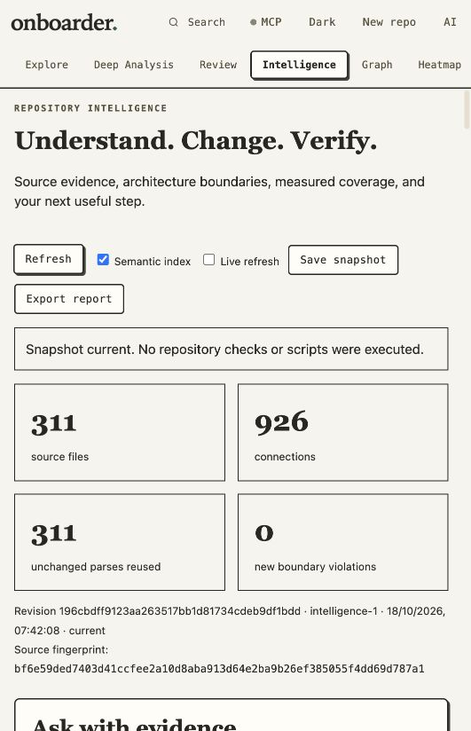

# Advanced feature verification — 18 October 2026

For subsequent Graph performance changes and the latest checks, see
[Graph verification](GRAPH_VERIFICATION.md). The archive checks below describe the
earlier advanced-feature snapshot.

This record covers the local, unreleased Onboarder source on `codex/hermes-harness`.
The application package version remains 1.0.4. Existing work was preserved; nothing
was pushed, published to npm or the VS Code Marketplace, or deployed to the VPS.

See [the feature and setup guide](ADVANCED_FEATURES.md) for supported behavior,
configuration, resource limits and integration requirements.

## Final checks

- Complete `npm run check`: **925 passed, zero failures, zero skipped**. The run
  included the real optional TypeScript 5.9.3 compiler integration.
- Main and selected strict TypeScript checks passed; **412 generated JavaScript
  and declaration files** matched the authored source.
- Supply-chain guard passed: **23 locked development dependencies, 98 verified
  browser vendor assets, 733 package files**. Core runtime dependencies remain zero.
- The project's new architecture rules passed with no new boundary violations.
- `git diff --check` passed.

## Installed package

The exact npm archive was installed into a separate temporary directory with
lifecycle scripts disabled and development dependencies omitted. All **733 files**
matched both the archive and workspace byte for byte.

Archive SHA-256:

    f9113404aacd095ff8543db5cf60d5f23c2fb3bfb7fbb1a7875e6bac50ceff23

The installed package passed actual CLI intelligence scans, source evidence,
real semantic indexing, staged review SARIF export, HTTP assets and intelligence
requests. Its separate MCP process passed initialization, repository scanning and
source-evidence calls. The handshake advertised 17 tools, five resource templates
and three guided prompts with protocol 2025-11-25.

The separately built VSIX passed ZIP integrity and XML validation (six files).
The extension activation harness invoked the actual CLI. An installed VS Code
GUI and Marketplace publication were not part of this verification.

## Browser workflows

The app's embedded browser was used against both a disposable Git fixture and
the actual project. Verified behaviors included:

- Actual-project intelligence: source relationships, authored onboarding journey,
  architecture rules and real compiler output, including a visible bounded-result
  label when the reference limit was reached.
- Exact staged patch retention: a later working-file edit did not replace the
  compared staged lines; Escape closed the patch and restored focus.
- Local evidence retrieval with paths, line ranges, hashes and related source.
- Streamed explanations, saved citations, immediate saved-question counts,
  separate conversation topics and retained history after reload.
- Private notes, onboarding completion, snapshots, impact paths, suggested tests
  and explicitly labeled static request-flow candidates.
- Live refresh: adding a source file changed the displayed file/connection counts
  and semantic definitions while preserving the question and implementation drafts.
- Connection settings preserved the active workspace and drafts.
- Saved exploration views: naming, listing and restoration through an accessible
  in-page dialog. The same dialog saved a reason for a confirmed finding.
- A 390-pixel viewport had no document-level horizontal overflow. Temporary
  viewport overrides were reset; no browser console warnings/errors were observed
  in the tested fixture session.

The implementation workflow used the real isolated agent harness with a
controlled local agent response. It changed storage and its regression test in a
separate worktree, created automatic checkpoints, executed the repository test
command with exit status zero, and returned a durable passing check receipt.
Both resulting file patches could be inspected. The original fixture source
remained unchanged. This verified execution and isolation; it did not call a live
AI model or establish the correctness of arbitrary future model-generated fixes.

## Integration boundaries

- AI streaming and implementation responses were controlled local fixtures. Live
  explanations and fixes require an existing configured provider/Hermes profile.
- GitHub webhook signatures, job persistence, duplicate suppression, exact-head
  protection and optional publication were exercised with controlled API responses.
  No live GitHub App, webhook, credentials or Check Run was provisioned/published.
- Team permissions were tested through real local HTTP routes with disposable
  identities, repository grants, reviewer/viewer restrictions and revoked sessions.
  No real members were added to the user's deployment.
- Measured coverage freshness and OTLP imports were tested with fixtures. The actual
  project correctly shows unknown measured coverage until an execution report and
  matching provenance are configured. No production collector was installed.
- Optional TypeScript indexing is real, bounded and limited to captured JavaScript
  and TypeScript source. Static import/reference candidates do not prove runtime
  execution, complete call graphs or semantic API compatibility.

## Local review

The final project preview is at [localhost:4337](http://127.0.0.1:4337) while its local process is
running. Open a repository and choose **Intelligence**. Rebuild from source to
restart elsewhere. The optional compiler used for verification lives in a temporary
QA directory; use the documented `intelligence semantic-setup` command for a durable
operator-managed installation.
