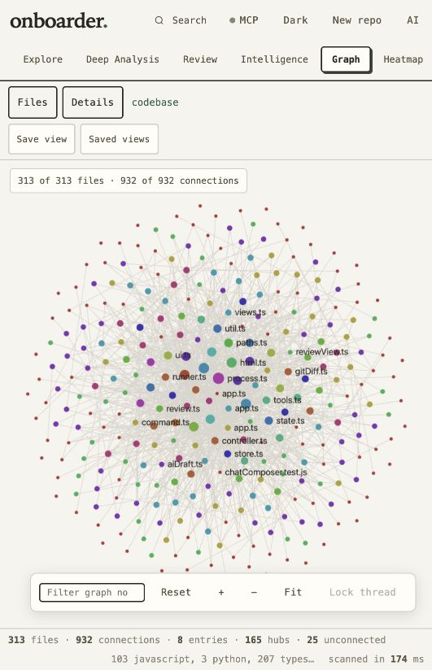

# Lightweight Graph — verification, 18 October 2026

The Graph view was changed in local source after reports of freezing and page
refreshes during use. This is an unpublished change to the 1.0.4 source tree.

## Changes

- Replaced the continuous force simulation with deterministic, stable placement.
  Painting now happens only after a source change, resize or interaction.
- Removed per-node/per-edge canvas blur. Connections and highlight rings use
  bounded drawing batches; nearby labels avoid overlapping each other.
- Coalesced rapid input into one scheduled paint. Hidden views/tabs cancel painting;
  teardown releases listeners, resize observation, timers and retained graph data.
- Limited the canvas backing buffer to two million pixels and its largest side
  to 4,096 pixels. Unchanged dimensions reuse the existing buffer. The absolutely
  positioned canvas cannot enlarge its flex container through intrinsic sizing.
- Bounded the overview at 700 files and 1,800 connections, with visible totals.
  Search covers all scanned files and includes immediate dependency context.
  This display limit does not remove files from the repository scan or source views.
- Preserved positions and zoom during unchanged source updates. Untouched graphs
  refit responsively; manual zoom preserves its scale and world center on resize.
- Suppressed accidental source navigation after dragging. Double-click centers a
  node; pending single-click navigation is cancelled on double-click, hide or teardown.

## Verification

The final complete `npm run check` passed **932 tests, zero failures and zero
skips**, including the real optional compiler integration. Type checks, architecture
gate and generated-output checks passed (414 JavaScript/declaration files).
Supply-chain validation passed with 23 locked development dependencies, 98 vendor
assets and 736 package files. No runtime dependency was added. `git diff --check`
passed.

Graph regression tests cover:

- Zero animation frames remaining when idle; pausing, resuming and teardown.
- One paint for 100 rapid resize/zoom requests and no repeated buffer allocation
  for unchanged dimensions, including a simulated Retina 6,000 × 4,000 container.
- Projection of 20,000 source files / 80,000 input edges into the bounded scene;
  search and focus finding files excluded from its initial overview.
- Dense 700-node / 50,000-input-edge rendering, bounded labels/drawing batches,
  hover without blur, and no continued animation afterward.
- Debounced search and cancelled navigation/search work after teardown.
- Drag/double-click navigation protection, position preservation and responsive fit.

The embedded browser was also checked with the actual project (313 source files,
932 import connections at verification time) and a disposable 1,200-file repository
with 3,600 imports. The large overview displayed its 700/1,800 limits. Searching
for a file outside that overview returned the file and six immediate connections.
Drag, thread locking/Escape, zoom, Fit, Reset and view switching completed without
browser warnings or errors in the tested session. Light/dark rendering and
390-pixel mobile / 1,173-pixel desktop sizing were checked; mobile had no page
horizontal overflow. Temporary viewport and theme changes were restored.

Synthetic canvas tests verify work bounds and scheduling; they do not measure
actual GPU time or guarantee identical responsiveness on every machine.

The running local preview is [localhost:4338](http://127.0.0.1:4338/).
